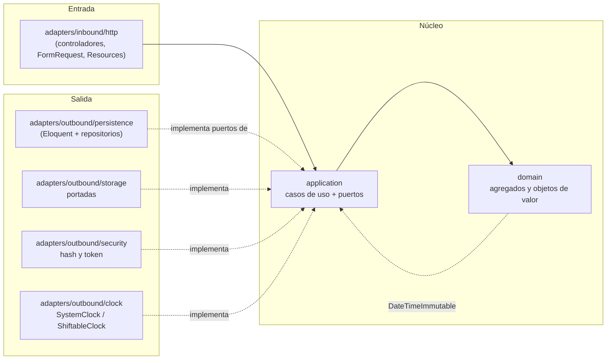
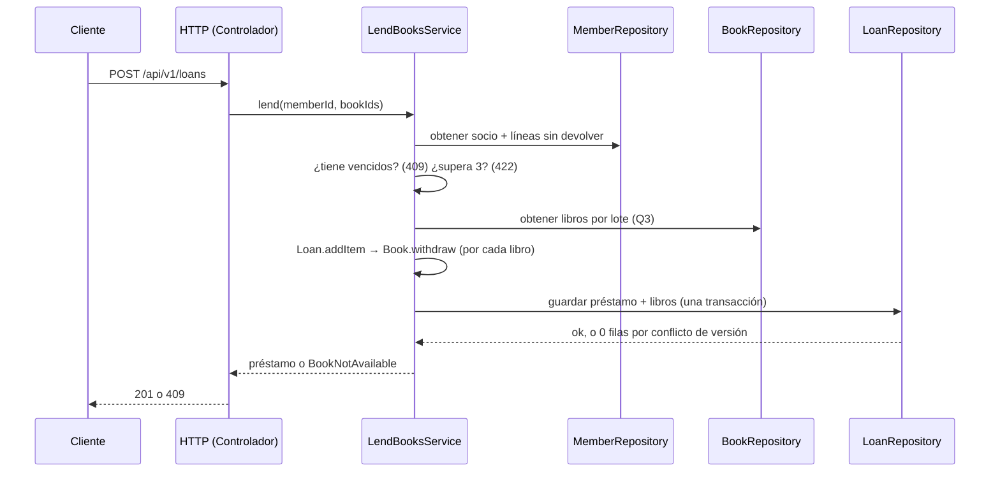

# Arquitectura — Manager Library (Laravel)

> **Fuente normativa:** [`../spec-python/architecture.md`](../spec-python/architecture.md). Traduce
> la forma del sistema al esqueleto de Laravel.

Arquitectura **hexagonal** (puertos y adaptadores). Las reglas de dependencia son los artículos I a
III de [`constitution.md`](constitution.md).

## 1. Capas y dependencias



Las flechas de dependencia apuntan **hacia adentro**. `Bootstrap/Composition` es el único que ve
las dos mitades.

La flecha punteada entre `domain` y `application` es conceptual, no un `use`: el dominio **no**
importa el puerto `Clock`. Quien lo consume —el caso de uso— lo invoca y le pasa el
`DateTimeImmutable` al dominio, de modo que el artículo I se sostiene sin relajar el artículo II
([INC-13](consistencia.md)).

## 2. Estructura de carpetas

Se conserva `app/` de Laravel, que da el autoload PSR-4, y dentro se reproduce la estructura del
spec. Los archivos que Laravel crea por defecto y que el modelo de datos prohíbe
(`app/Models/User.php`, factories y seeders de ejemplo) **se borran**.

```text
app/
├── Domain/                         # Artículo I: solo PHP estándar
│   ├── Book/        Book.php, Isbn.php, CoverKey.php
│   ├── Loan/        Loan.php, LoanItem.php, LoanStatus.php, DateRange.php
│   ├── Member/      Member.php, DocumentNumber.php
│   ├── User/        UserName.php, Role.php
│   └── Category/    CategoryName.php
├── Application/                    # Artículo II: solo conoce el dominio
│   ├── Ports/Outbound/   BookRepository, LoanRepository, MemberRepository, UserRepository,
│   │                     ReportReader, Clock, PasswordHasher, TokenIssuer, CoverStorage
│   ├── Services/         LendBooksService, ReturnItemService, CreateBookService,
│   │                     SearchBooksService, OverdueService, MostBorrowedReportService,
│   │                     LoginService, CreateLibrarianService, …
│   └── Exceptions/       BookNotAvailable, MemberHasOverdue, MemberLimitExceeded, …
├── Adapters/
│   ├── Inbound/Http/     Controllers/, Requests/, Resources/, Middleware/
│   ├── Outbound/Persistence/  Book.php, Loan.php, Member.php, User.php, Category.php,
│   │                        LoanItem.php (Eloquent), *Repository.php, MostBorrowedReportReader.php
│   ├── Outbound/Security/     Argon2PasswordHasher.php, JwtTokenIssuer.php
│   ├── Outbound/Storage/      FilesystemCoverStorage.php
│   └── Outbound/Clock/        SystemClock.php, ShiftableClock.php
└── Bootstrap/Composition/PortBindings.php   # artículo III: único punto de composición
```

Nombres en inglés, mensajes al usuario en español (artículo XI). Los modelos Eloquent **viven** en
`Adapters`, nunca en `Domain`: un modelo de Active Record es infraestructura.

## 3. Agregados

| Raíz | Contiene | Invariantes que defiende |
|---|---|---|
| `Book` | `Isbn`, copias totales y disponibles, baja lógica | disponibles entre 0 y total; total ≥ 1; título no vacío |
| `Loan` | colección de `LoanItem` | 1 a 3 líneas; sin libro repetido; vencimiento a 14 días; inmutable salvo devolución |
| `Member` | documento | documento obligatorio y único |
| `User` | rol, hash | nombre normalizado; rol en (`admin`, `librarian`) |

`Loan::addItem()` descuenta el ejemplar antes de añadir la línea: descontar el ejemplar y crear la
línea son **una sola operación**. `Loan::returnItem()` repone **una sola vez** por línea.

El objeto de dominio `Book` **no** conoce la persistencia: el valor esperado para el
compare-and-swap lo conserva el repositorio, en el adaptador
([ADR-005](adr/adr-005-compare-and-swap.md)).

## 4. Flujo: registrar un préstamo



El orden de las dos validaciones de socio está resuelto por el propio spec:
`architecture.md` §4 pregunta primero «¿tiene vencidos?» y después «¿supera 3?». Ver
[INC-12](consistencia.md).

## 5. Errores

El dominio y la aplicación lanzan errores propios (`BookNotAvailable`, `MemberHasOverdue`,
`MemberLimitExceeded`, `DuplicateBookInLoan`, `ItemAlreadyReturned`, …). **Solo** el adaptador HTTP
los traduce al cuerpo único y al código de estado de
[`../spec-python/api-contract.md`](../spec-python/api-contract.md), y lo hace en un único manejador
global ([ADR-008](adr/adr-008-cuerpo-de-error-unico.md)). Un error de framework nunca llega al
cliente: nunca se formatea una respuesta desde el controlador.

## 6. Qué no hay

Sin eventos, sin colas, sin caché, sin microservicios, sin multi-tenencia, sin rate limiting. Se
añaden si un requisito lo pide, no antes.
