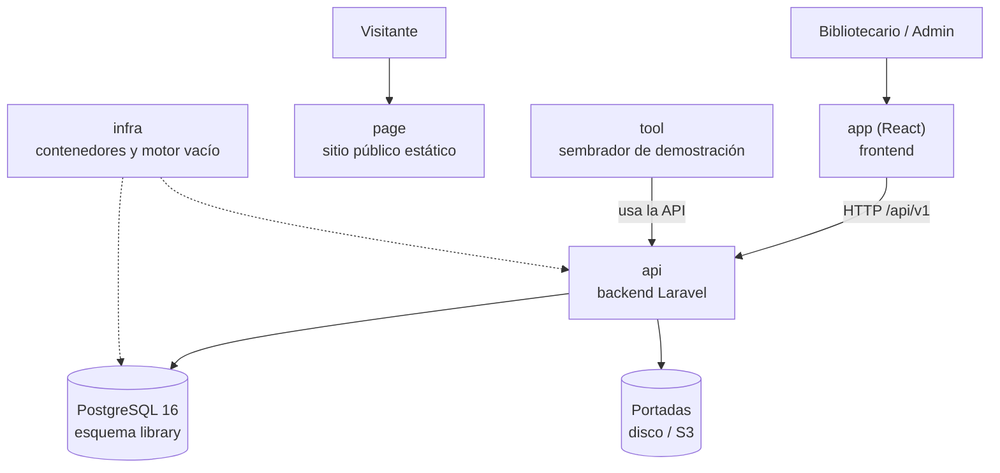

# Arquitectura en una página — Manager Library (Laravel)

> **Fuente normativa:**
> [`../spec-python/arquitectura-panoramica.md`](../spec-python/arquitectura-panoramica.md). Solo
> cambia la tecnología del backend. El sistema es el mismo.

Para leer en cinco minutos antes de abrir el resto. El detalle está en
[`architecture.md`](architecture.md).

## El sistema en una imagen

## Los seis repositorios y su papel

| Repo | Papel | Se prueba con |
|---|---|---|
| `docs` | La especificación y su traducción a React + Laravel | Que esta lectura baste para construir |
| `api` | Reglas de negocio y contrato HTTP | Pruebas de dominio, aplicación, contrato, concurrencia y arquitectura |
| `app` | Pantallas de operación | Un recorrido de punta a punta: login → prestar → devolver → reporte |
| `page` | Presentación pública, sin llamar a la API | Que se vea bien en móvil y escritorio |
| `infra` | `docker compose up` y la base vacía | Que arranca con un solo comando |
| `tool` | Datos de demostración (libros, socios, préstamos) | Que la feria de presentación tenga datos reales |

## Las cinco ideas que sostienen el diseño

1. **El préstamo es un hecho inmutable**; solo cambia `returned_at` de una línea.
2. **Los ejemplares se descuentan y se devuelven dentro de la misma operación** que crea o cierra
   la línea.
3. **El estado se calcula**: `open`, `overdue` o `closed` no están en la base.
4. **Lo congelado no sigue al catálogo**: el reporte de octubre no cambia porque en noviembre se
   renombre un libro.
5. **La base es la última barrera**: si el `CHECK` de ejemplares salta, algo escribió fuera del
   sistema.

## Las cinco diferencias que impone el stack

Estas no cambian el producto; son las traducciones que la Constitución obliga a resolver y que
están justificadas en [`consistencia.md`](consistencia.md).

| # | En el spec de referencia | En Laravel |
|---|---|---|
| 1 | Testigo de versión **almacenado** en el libro | El testigo es `available_copies`: compare-and-swap, sin columna nueva ([ADR-005](adr/adr-005-compare-and-swap.md)) |
| 2 | El ORM entrecomilla `"user"` solo | Eloquent y las migraciones entrecomillan `library."user"`; el esquema se fija con `search_path` |
| 3 | Token JWT sin estado con una librería propia | `firebase/php-jwt`, porque Sanctum y `tymon/jwt-auth` crearían una séptima tabla ([ADR-006](adr/adr-006-jwt-sin-estado.md)) |
| 4 | El reloj es un puerto, sin impasse | Se aprovecha: es lo que permite que el sembrador produzca vencidos sin esperar 14 días ([ADR-007](adr/adr-007-reloj-como-puerto.md)) |
| 5 | Manejo de errores por endpoint | Un único manejador global: el contrato exige un cuerpo único para **todo** error HTTP ([ADR-008](adr/adr-008-cuerpo-de-error-unico.md)) |
